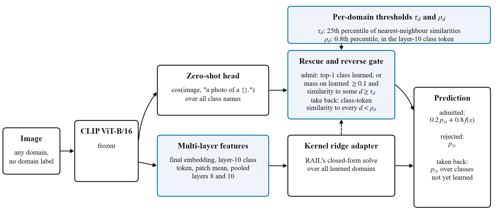
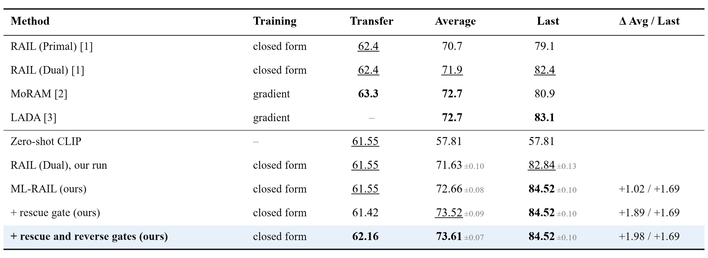
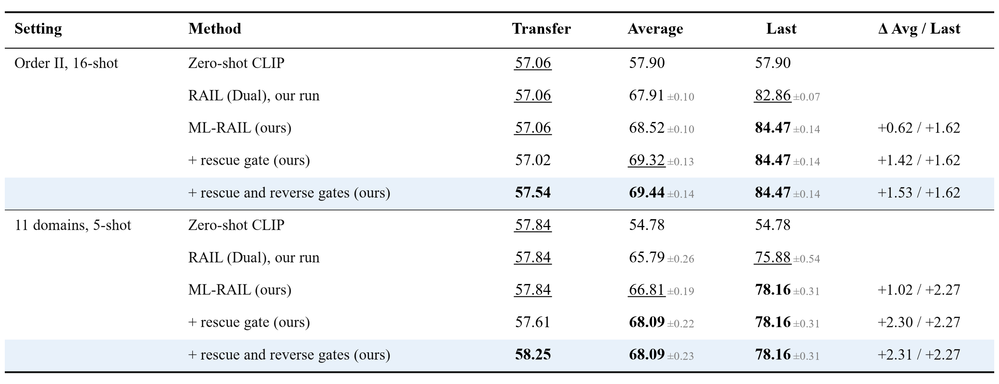
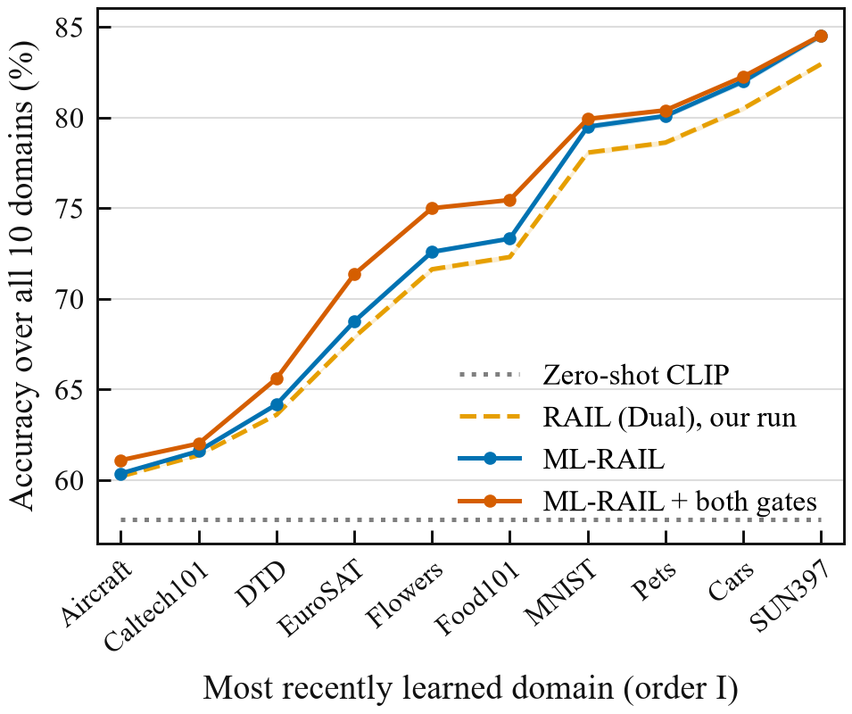
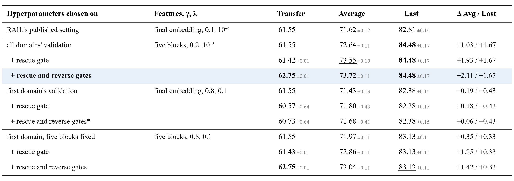
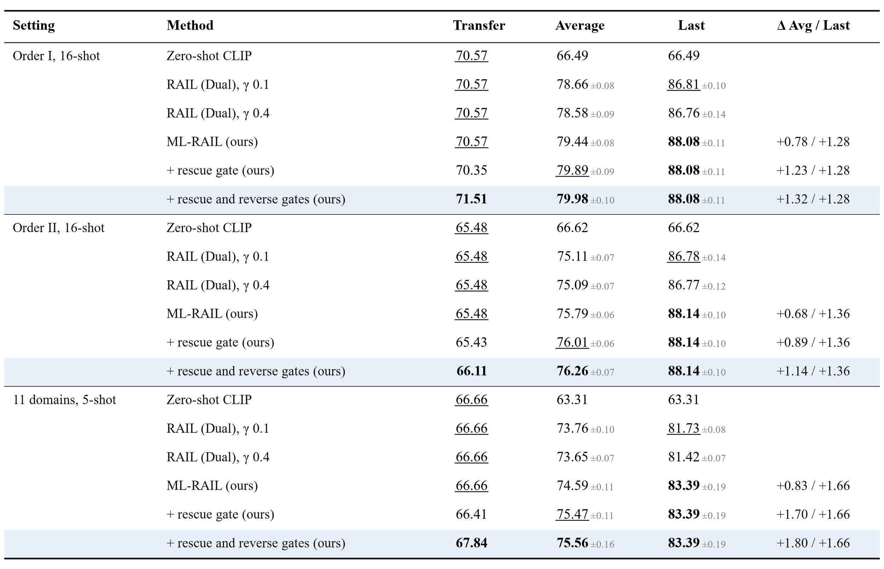
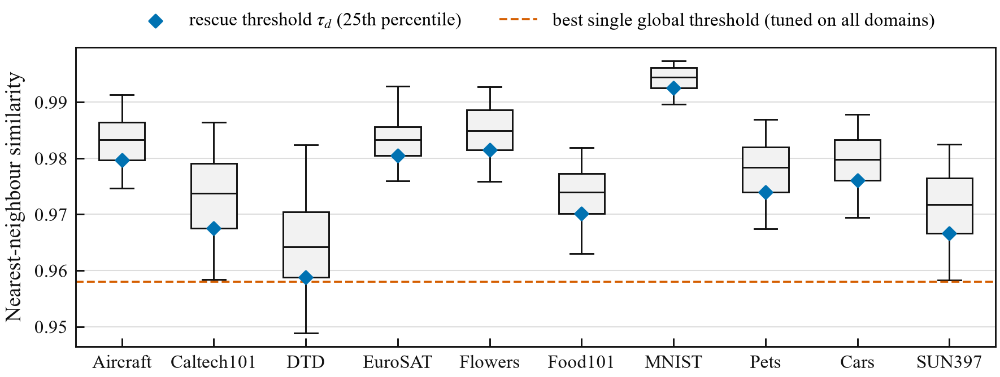
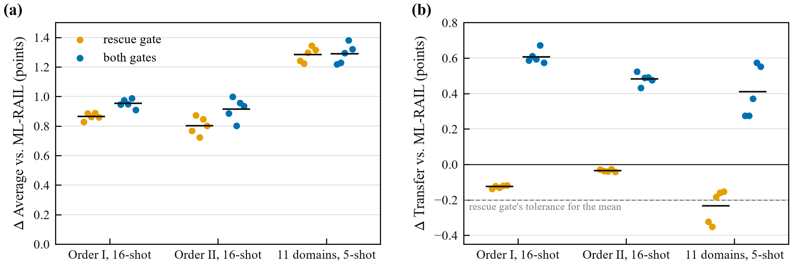
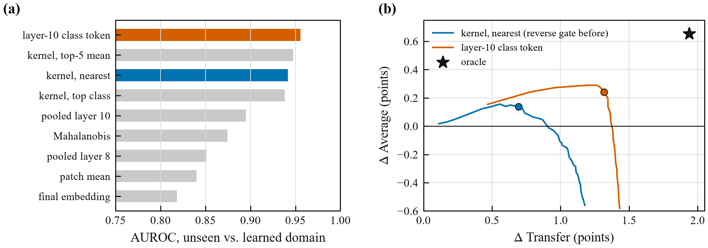

# ML-RAIL: Training-Free Continual Learning for CLIP with Per-Domain Gating

[](https://github.com/EdwardGlockner/ml-rail/actions/workflows/tests.yml)
[](LICENSE)

A frozen CLIP model learns ten image domains in sequence from 16 examples per class, without gradient
training and without forgetting. It extends RAIL (NeurIPS 2024) [1] with the same inputs: the same
frozen backbone, shots, class names and prompt. On held-out seeds of the X-TAIL benchmark it reaches
**62.75 Transfer, 73.76 Average and 84.53 Last accuracy**, against 61.55 / 71.71 / 82.94 for RAIL in the
same harness. Transfer is the accuracy on domains not yet learned. Here it ends up 1.2 points above
zero-shot CLIP's, which RAIL-style methods otherwise inherit unchanged. On a second backbone, CLIP
ViT-L/14, with every setting kept, the gains are smaller but hold in every setting (Table 4).

The method has three parts:

- **ML-RAIL** gives RAIL's closed-form kernel ridge adapter a multi-layer view of each image, following
  LayUP [4].
- **A rescue gate** admits test images that RAIL's zero-shot router wrongly keeps away from the adapter.
- **A reverse gate** takes back images that the router wrongly sends to the adapter, which can only name
  classes already learned.

Both gates compare an image's similarity to each learned domain against thresholds that the domain sets
from the spread of its own training images. The reverse gate measures that similarity on the layer-10
class token, the signal that best separates unseen from learned domains among those tested (Figure 5).

Two caveats matter for reading the numbers:

- The hyperparameters were chosen on validation data from all ten domains; RAIL chooses its own on the
  first domain only. Keeping the five feature blocks and choosing only γ and λ on the first domain, the full
  method still gains +1.20 Transfer, +1.42 Average and +0.33 Last over RAIL. Under RAIL's full protocol,
  with the feature set chosen on the first domain too, the selection falls back to RAIL's final embedding.
  The class-token gate is then unavailable, and the gain is gone: −0.82 / +0.06 / −0.43 (Table 3).
- The rescue gate on its own costs Transfer. At 5 shots it misses its 0.2-point tolerance on two of four
  seed sets. With the reverse gate added, Transfer is above ML-RAIL's on every seed in every setting.

<p align="center"></p>
<p align="center"><sub><b>Figure 1.</b> Overview. Highlighted components are added to RAIL; the backbone is never trained.</sub></p>

## Results

X-TAIL (cross-domain task-agnostic incremental learning) [1] learns ten domains in sequence. After every
step, the model classifies test images from all domains among ~1,100 class names, with no domain label.

- **Transfer:** accuracy on domains not yet learned.
- **Average:** accuracy over all steps.
- **Last:** accuracy after the final step.

All numbers below are on seeds 16–20, run once after every setting was fixed. Two earlier held-out runs,
seeds 6–10 and 11–15, agree with them to within 0.2 for every method they share (in
[results/xtail_results.json](results/xtail_results.json)).

<p align="center"></p>
<p align="center"><sub><b>Table 1.</b> X-TAIL, order I, 16 shots per class, CLIP ViT-B/16. Top: numbers as published (RAIL from arXiv:2406.18868v3; LADA quotes Dual-RAIL as 71.3 Average and reports Transfer under a different definition). Bottom: this repository's harness, mean ± std over seeds 16–20; Δ is the gain over RAIL run in the same harness. Rankings (<b>bold</b>: best, <u>underlined</u>: second) are within each block, since the two blocks come from different code. Transfer has no spread where unseen domains are classified by zero-shot CLIP alone.</sub></p>

- These numbers are above the published ones we found as of October 2026 on Average and Last (MoRAM and
  LADA, 72.7 Average; LADA, 83.1 Last). Transfer stays below MoRAM's 63.3.
- That comparison crosses harnesses. Our run of Dual-RAIL gives 61.55 / 71.71 / 82.94, against 62.4 / 71.9
  / 82.4 published. RAIL's official code, with small compatibility fixes, gives 61.5 / 71.2 / 82.3.
- R²A²-MoE (2025), an analytic method that could compete, was not accessible to check.

<p align="center"></p>
<p align="center"><sub><b>Table 2.</b> The other task order and a 5-shot, 11-domain variant (CIFAR-100 added), with every setting kept from order I. Mean ± std over seeds 16–20. Published numbers exist for order II (RAIL, LADA) and for a 5-shot variant (arXiv:2601.22828), but they come from other code, so only the same-harness differences are compared here.</sub></p>

<p align="center"></p>
<p align="center"><sub><b>Figure 2.</b> Accuracy over all ten domains after each learning step (order I, mean of seeds 16–20; shaded: ±1 std).</sub></p>

### Effect of the tuning protocol

<p align="center"></p>
<p align="center"><sub><b>Table 3.</b> ML-RAIL with hyperparameters chosen on all domains' validation data (as above) or on the first domain's only (RAIL's protocol, by validation regression error). Order I, seeds 6–10. The gates' settings stay at the values chosen on all domains, because measuring their effect on Transfer needs domains not yet learned. *The final embedding alone has no layer-10 class token, so this row uses the reverse gate on the full kernel (1st percentile).</sub></p>

- Selecting the feature set on the first domain alone picks RAIL's final embedding with a wider kernel. That
  is *worse* than RAIL's published setting. The validation errors of all three feature sets are within 4%
  of each other on that one domain, so the selection is close to noise.
- With that wide kernel the gates fail too. The rescue gate costs a full Transfer point, and a reverse gate
  on the same features wins back only 0.16 of it.
- With ML-RAIL's five blocks kept and only γ and λ chosen on the first domain, ML-RAIL gains +0.35 Average
  and +0.3 Last over RAIL. The gates work as before on top of it, and the class-token reverse gate adds the
  same +1.3 Transfer as under all-domain tuning.

### Second backbone: CLIP ViT-L/14

<p align="center"></p>
<p align="center"><sub><b>Table 4.</b> CLIP ViT-L/14 (24 layers), seeds 16–20, with every setting kept from ViT-B/16: γ, λ, fusion weight and both gates. The feature blocks sit at the same relative depths (class token at layer 20; pooled patch tokens at 16 and 20). RAIL also appears with γ 0.4, the width ViT-L/14's validation prefers. Δ is against the stronger of the two RAIL rows.</sub></p>

- **Every part of the rule set before the run passed in all three settings:**
  - ML-RAIL above the stronger RAIL on Average and Last;
  - both gates above ML-RAIL on Average and Transfer;
  - Transfer above zero-shot CLIP's.
- **The gains are smaller than on ViT-B/16:** order I gives +0.94 Transfer, +1.32 Average and +1.28 Last,
  against +1.20 / +2.05 / +1.59. The stronger backbone leaves less for the adapter and the gates to fix.
- **ML-RAIL's kernel width needs no change:** validation on ViT-L/14 also picks γ 0.2. For RAIL,
  validation prefers 0.4, but on test it is slightly worse than 0.1.
- **The rescue gate alone again costs Transfer beyond its tolerance** on order I (−0.21) and at 5 shots
  (−0.25). The reverse gate recovers it with room to spare (+1.16 and +1.43).

## Method

**ML-RAIL.** Each image is encoded once by frozen CLIP ViT-B/16. Five blocks are taken from that single
forward pass: the final embedding, the layer-10 class token, the mean patch token, and GeM-pooled patch
tokens of layers 8 and 10. Each block is $\ell_2$-normalized and the blocks are concatenated into $x$. With
$X$ the stored training features of all learned domains and $Y$ their one-hot labels, the adapter is RAIL's
kernel ridge regression with an RBF kernel:

$$f(x) = k(x, X)\,(K + \lambda I)^{-1} Y, \qquad k(x, x') = \exp(-\gamma \lVert x - x' \rVert^2).$$

The solution is exact and does not depend on the order in which domains arrive, so nothing is forgotten.
The joint solve over all domains matters, because the other domains act as negatives. Separate per-domain
models collapse (Last 84.9 → 61.4). The multi-layer idea is LayUP's [4], proposed for
class-incremental learning with random-projection classifiers; here it is applied to RAIL's dual adapter.

**Per-domain thresholds.** For each learned domain $d$, take every training image's similarity to its
nearest neighbour among $d$'s other training images. A percentile of these values is $d$'s threshold:

- $\tau_d$, the 25th percentile of kernel similarities $k(x, x')$, for the rescue gate;
- $\rho_d$, the 0.8th percentile of cosine similarities between layer-10 class tokens, for the reverse gate.

$s_d(x)$ and $c_d(x)$ denote a test image's highest kernel and class-token similarity to $d$'s stored
images.

**Rescue gate.** RAIL applies the adapter only when zero-shot CLIP's top-1 class belongs to a learned
domain. With an oracle gate, Average would rise by 1.5 points, all from learned-domain images that zero-shot
CLIP confuses with a class not yet learned. The rescue gate also admits an image if:

- zero-shot CLIP puts at least $m = 0.1$ probability on learned classes, and
- $s_d(x) \geq \tau_d$ for some learned domain $d$.

**Reverse gate.** An admitted image of a domain not yet learned is wrong for certain, because the adapter
only scores learned classes. This happens to 4–5% of such images. An admitted image is taken back if
$c_d(x) < \rho_d$ for *every* learned domain $d$. It is then predicted as zero-shot CLIP's best class among
those not yet learned.

**Prediction.** Admitted images are scored as $0.2\,p_{zs} + 0.8\,f(x)$, as in RAIL; rejected images keep
$p_{zs}$. Last is unchanged by construction: after the final step every class is learned, so every image is
admitted and nothing can be taken back.

Neither gate carries a coverage guarantee. As a check, 76% of each domain's own test images clear its
$\tau_d$ (nominal 75%; per domain 71–79%; seeds 6–10).

## Analysis

**Why per-domain thresholds.** A single global similarity threshold only works when it is tuned on the
domains it is tested on. Tuned on half the domains and tested on the other half, it changes Average by
−1.4 to +0.65. Domains differ in how tightly their images cluster (Figure 3). Thresholds set per domain from
its own training images put all domains on one scale, and in the same split test they gave +0.55 to +0.86.
This check stays within X-TAIL's ten domains; a different benchmark could still behave differently.

<p align="center"></p>
<p align="center"><sub><b>Figure 3.</b> Nearest-neighbour kernel similarity among each domain's training images, seed 16 (box: quartiles; whiskers: 5th–95th percentile). Diamonds: rescue thresholds τ<sub>d</sub>. Dashed: the best single global threshold, tuned on all ten domains' validation data.</sub></p>

**Effect of the gates** (Figure 4, change over ML-RAIL).

- **Rescue gate:** raises Average on every seed (+0.80 to +1.30 on the mean) at a Transfer cost. The cost
  is small with 16 shots (−0.04 and −0.13) but larger with 5 shots (−0.15 to −0.23 across seed sets). A
  plausible cause, not tested, is that each threshold is estimated from fewer images.
- **Both gates:** Transfer +1.20, +0.77 and +1.45, and Average +1.07, +1.18 and +1.53 (order I, order
  II, 5-shot). Both are positive on every seed.
- **Sensitivity:** the rescue gate's settings are not sharp. Over $q \in \{0.25, 0.5\}$ and
  $m \in \{0.05, 0.1\}$ the Average gain is +0.69 to +0.92, and the Transfer cost −0.09 to −0.21.

<p align="center"></p>
<p align="center"><sub><b>Figure 4.</b> Change over ML-RAIL from the rescue gate alone and from both gates, per held-out seed 16–20 (bar: mean). (a) Average. (b) Transfer; dashed: the rescue gate's tolerance for its mean Transfer cost, set before its run.</sub></p>

**How far can taking images back go?** The ceiling is an oracle that takes back exactly the admitted
images of unseen domains: +1.9 Transfer on order I (development seeds).

- **Why the ceiling isn't larger.** Only 4–5% of unseen-domain images get admitted at all. For those,
  zero-shot CLIP's best not-yet-learned class is right about 44% of the time. The rest of the Transfer
  error is zero-shot CLIP's own, among the classes not yet learned, which no gate can fix.
- **Which signal.** Among the training-free signals tried, the layer-10 class token separates admitted
  unseen-domain images from learned-domain ones best (AUROC 0.956, against 0.942 for the full kernel).
  Mahalanobis distance, pooled patch tokens and the final embedding do worse (Figure 5a). Adding zero-shot
  or adapter confidence to the full-kernel rule did not help either.
- **How much of it is reached.** The class-token reverse gate reaches about 70% of the ceiling on order I
  (+1.32 of +1.94), against 35% for a reverse gate on the full kernel. It also gains more Average (Figure
  5b). The share is 46% on order II and 64% at 5 shots.
- **What is left.** Mostly Food101, Flowers and some SUN397 images that look like Caltech101's own
  training images: Caltech101 has classes such as pizza, sunflower and lotus. Telling them apart by
  similarity seems out of reach.

A plausible reason the class token works, not tested: intermediate-layer class tokens keep more domain and
style information, while the final embedding is shaped toward semantics, where Caltech101's broad object
classes overlap other domains.

<p align="center"></p>
<p align="center"><sub><b>Figure 5.</b> Take-back signals, order I, development seeds 1–5. (a) AUROC of each signal for "admitted image is from a domain not yet learned". (b) Change in Transfer and Average over ML-RAIL + rescue gate as the reverse threshold loosens, for the full kernel and the layer-10 class token. Dots: thresholds chosen on validation; star: the oracle.</sub></p>

## How the result was reached

- **Rules first:** before each experiment, its settings and a pass/fail rule were fixed in a short note
  (the notes are not part of this repository). Hyperparameters were chosen on CoOp validation splits.
- **Rescue gate:**
  - Tested in two rounds on development seeds 0–5. The first version ($m = 0.05$) cost 0.27 Transfer
    points in the 5-shot setting and failed its rule. The second ($m = 0.1$) still exceeded the 0.2
    tolerance at 5 shots (−0.214).
  - Seed 1 was also used during gate selection, so the result was rerun on fresh seeds 6–10.
  - Its 5-shot Transfer cost has since been −0.164, −0.234 and −0.154 on seeds 6–10, 11–15 and 16–20.
    On its own it does not reliably meet its tolerance at 5 shots.
- **Reverse gate, first version (full kernel):**
  - Motivated by an oracle measurement of where Transfer is lost.
  - Its percentile (1st) was the loosest in the grid that kept Average from falling on validation.
  - It passed its rule (mean ΔTransfer ≥ +0.3, ΔAverage ≥ 0, ΔTransfer > 0 on every seed) on
    development seeds 1–5 and on fresh seeds 11–15: about +0.5 to +0.7 Transfer.
- **Reverse gate, class token:**
  - A study of take-back signals (Figure 5) found the layer-10 class token.
  - **Disclosure:** the old selection rule ("most Transfer with no loss in Average") pushes this signal's
    threshold too loose, so the selection criterion was changed, after seeing the development seeds, to
    the most Transfer + Average on validation. For the full-kernel signal the new criterion picks the
    same threshold as before (1.1st percentile against the 1st), so it does not favour the new signal.
  - The class-token gate had to beat the full-kernel gate by at least +0.2 Transfer with no loss in
    Average. It did, on development seeds 1–5 in all three settings (+0.66, +0.28, +1.02).
  - It did again in the final run on fresh seeds 16–20 (+0.70, +0.30, +0.93), positive on every seed.
- **Replication:** RAIL was reproduced with its official code (61.5 / 71.2 / 82.3) and with this
  repository's independent harness before any comparison. The changes needed to run the official code are
  listed in [third_party/RAIL_CHANGES.md](third_party/RAIL_CHANGES.md).
- **Fair baselines:** any change that is not part of the method, such as prompts or features, was also
  applied to the baselines.
- **Precision:** the reported runs solve in float32. A float64 run of seed 6 (without the reverse gate)
  matches within 0.05 points.

## Related work

- **RAIL** [1] introduced X-TAIL and the closed-form adapter with zero-shot routing that this work extends.
  **MoRAM** [2] and **LADA** [3] are the strongest published X-TAIL results, both gradient-trained.
- **LayUP** [4] showed that multi-layer features help rehearsal-free continual learning. **RanPAC** [5] and
  analytic learning (ACIL, GKEAL) [6] are the closed-form classifier family RAIL belongs to.
- **DIKI** [7] is the closest prior work to the rescue gate. It fits a Gaussian per task on frozen features
  and uses the likelihood to weight task knowledge against frozen CLIP. It is trained, evaluated on MTIL,
  and reports no X-TAIL numbers. The rescue gate differs in being training-free, nonparametric, and
  calibrated per domain from nearest-neighbour similarities.
- **LADA** [3] already observed that learned knowledge can improve Transfer by separating learned from
  unseen classes, and its own Transfer measure exceeds zero-shot CLIP's. It does so with trained modules.
  The reverse gate is a training-free, explicit version of that idea inside RAIL's fusion. MoRAM [2] also
  exceeds zero-shot Transfer, through continual adaptation.
- **kNN-based OOD detection** [8] scores test images by nearest-neighbour distance to training features.
  Kim et al. [9] link task-incremental prediction to out-of-distribution detection. Per-group quantile
  thresholds resemble **Mondrian conformal prediction** [10], but no coverage guarantee is claimed here.

## Limitations

- Two backbones of one family (CLIP ViT-B/16 and ViT-L/14) and one benchmark family. The tuning-protocol
  check and the signal study are on ViT-B/16 only.
- The headline gain depends on tuning with all domains' validation data (Table 3). Under RAIL's full
  first-domain protocol it disappears.
- The reverse gate's selection criterion was changed after seeing development results (see above).
- The rescue gate alone is unreliable at 5 shots, and on ViT-L/14 also on order I; the combined method
  is not.
- The dual adapter stores all training features, as RAIL's does. A fixed-memory version with random
  features comes within 0.3 Average and 0.5 Last.
- The rescue gate recovers about 60% of its oracle's Average headroom, and the reverse gate about 70% of
  its oracle's Transfer headroom on order I.

## Future work

- **The rest of the Transfer ceiling** is mostly images that resemble another domain's classes. Telling
  them apart probably needs class-level semantics, not domain similarity. Beyond the ceiling, Transfer is
  CLIP's own error on unseen classes. A prior learned from past domains, tried earlier, only tied CLIP's
  own class-name embeddings ([research log](docs/RESEARCH_LOG.md)).
- **The rescue gate on the class token.** It is the mirror image of the reverse gate and might gain from
  the same signal.
- **Thresholds with few shots.** Shrinking per-domain thresholds toward a pooled estimate may reduce the
  rescue gate's 5-shot Transfer cost.
- **Tuning on the first domain.** A selection criterion that is less noisy on a single domain than
  regression error.
- **Other pretraining and longer streams.** SigLIP or another non-CLIP backbone, and streams of 20 or more
  domains for the fixed-memory adapter.

## Project history

The project began as *Plastic Primitive Networks*: a gradient-free dictionary of visual primitives that
creates, merges, prunes and splits its own entries on a frozen backbone. It beat fixed and online
dictionaries but lost to properly tuned published continual learners, so it was stopped by its own kill
criteria; its code is not part of this repository. The work then moved to X-TAIL.

- [docs/RESEARCH_LOG.md](docs/RESEARCH_LOG.md): the full path, including negative results.
- [docs/REPORT_XTAIL.md](docs/REPORT_XTAIL.md): the technical report.
- [docs/WRITEUP.md](docs/WRITEUP.md): a short paper-style write-up of the method and results.

## Reproducing

```bash
pip install -r requirements.txt      # Python 3.11; install a GPU build of torch first if you have one
export XTAIL_ROOT=/path/to/storage   # data and feature caches (default: ./xtail_data, ~50 GB)

python scripts/reproduce.py                  # every step below, in order; resumes if interrupted
python scripts/reproduce.py --from evaluate  # once the data and features are cached
```

| Step | Script |
|:--|:--|
| Download and verify the datasets | `scripts/setup_xtail_data.py` |
| Cache CLIP ViT-B/16 features, then the intermediate layers | `scripts/xtail_encode.py`, `scripts/xtail_encode_extra.py` |
| Tables 1–2 on seeds 16–20, and the earlier runs on seeds 6–10 and 11–15 | `scripts/evaluate.py` |
| ViT-L/14: features, kernel-width check, Table 4 | `scripts/xtail_encode_backbone.py`, `scripts/experiments/run_xtail_backbone_gamma.py`, `scripts/evaluate.py --backbone vitl14` |
| Table 3 and the rescue gate's checks | `scripts/experiments/run_xtail_first_domain_tuning.py`, `run_xtail_gate_sensitivity.py` |
| Reverse gate: headroom, take-back signals (Figure 5) | `scripts/experiments/run_xtail_transfer_headroom.py`, `run_xtail_ceiling_signals.py`, `run_xtail_takeback_signals.py` |
| Figures, tables, `results/xtail_results.json` | `scripts/plot_xtail_figures.py` |

The per-seed metrics and accuracy tables behind Tables 1–3 are in
[results/xtail_results.json](results/xtail_results.json), so the reported numbers can be checked without the
datasets. Run the tests with `python -m pytest tests/ -q`.

```text
evaluation/ml_rail.py          ML-RAIL: feature blocks and the adapter
evaluation/xtail_protocol.py   X-TAIL protocol and metrics, RAIL adapters, DomainThresholdGate (both gates), run_stream
evaluation/xtail_variants.py   variants that were tested and did not help
evaluation/xtail_prompts.py    zero-shot text heads
data/real/xtail.py             dataset loaders and XTAIL_ROOT
scripts/                       the pipeline above; run_xtail.py runs single methods (RAIL replication)
scripts/experiments/           development experiments (table below)
results/                       per-seed results
tests/                         unit tests
third_party/                   CLIP's prompt templates (MIT) and the RAIL code changes
```

Development scripts keep the labels their cached results use: `Aprime` is ML-RAIL, `conformal` is the
rescue gate (at $m = 0.05$ in `xtail_lora.py`), and `C0`, `A1`, … name variants in `run_xtail_analysis.py`.

| Development experiment (seeds 0–5 and validation) | Script (in `scripts/experiments/`) |
|:--|:--|
| Hyperparameter and feature selection on validation | `run_xtail_tune.py`, `run_xtail_tune_val4.py`, `run_xtail_improve.py` |
| Zero-shot text heads | `run_xtail_zeroshot.py` |
| Oracle gate headroom, per-domain variants, looser gates | `run_xtail_analysis.py` |
| Signals for gating and the split-domain check | `run_xtail_gatesep.py`, `run_xtail_gatesep_explore.py` |
| Rescue gate selection on development seeds | `../run_xtail_routegate.py` |
| Transfer headroom and the full-kernel reverse gate | `run_xtail_transfer_headroom.py` |
| Take-back signals per feature block (the class-token signal) | `run_xtail_ceiling_signals.py` |
| Zero-shot and adapter take-back signals (negative) | `run_xtail_takeback_signals.py` |
| Gate-free residual model | `run_xtail_residual.py` |
| Spatial readouts for fine-grained domains | `run_xtail_spatial.py`, `xtail_encode_patches.py`, `xtail_encode_layerpatch.py`, `xtail_encode_tiles.py` |
| Fixed-memory adapter (random features) | `run_xtail_bounded.py` |
| Per-domain LoRA experts | `xtail_lora.py` |

## References

1. Xu et al. *Advancing Cross-domain Discriminability in Continual Learning of Vision-Language Models* (RAIL). NeurIPS 2024; arXiv:2406.18868.
2. *Little by Little: Continual Learning via Incremental Mixture of Rank-1 Associative Memory Experts* (MoRAM). arXiv:2506.21035, 2025.
3. *LADA: Scalable Label-Specific CLIP Adapter for Continual Learning*. ICML 2025; arXiv:2505.23271.
4. Ahrens et al. *Read Between the Layers: Leveraging Multi-Layer Representations for Rehearsal-Free Continual Learning with Pre-Trained Models* (LayUP). arXiv:2312.08888.
5. McDonnell et al. *RanPAC: Random Projections and Pre-trained Models for Continual Learning*. NeurIPS 2023.
6. Zhuang et al. *ACIL: Analytic Class-Incremental Learning with Absolute Memorization and Privacy Protection*. NeurIPS 2022; *GKEAL: Gaussian Kernel Embedded Analytic Learning for Few-Shot Class Incremental Task*. CVPR 2023.
7. Tang et al. *Mind the Interference: Retaining Pre-trained Knowledge in Parameter Efficient Continual Learning of Vision-Language Models* (DIKI). ECCV 2024; arXiv:2407.05342.
8. Sun et al. *Out-of-Distribution Detection with Deep Nearest Neighbors*. ICML 2022.
9. Kim et al. *A Theoretical Study on Solving Continual Learning*. NeurIPS 2022.
10. Vovk et al. *Mondrian Confidence Machine*. 2003; see Vovk, Gammerman and Shafer, *Algorithmic Learning in a Random World*.

## License

MIT; see [LICENSE](LICENSE). Third-party notices are in [third_party/README.md](third_party/README.md).
